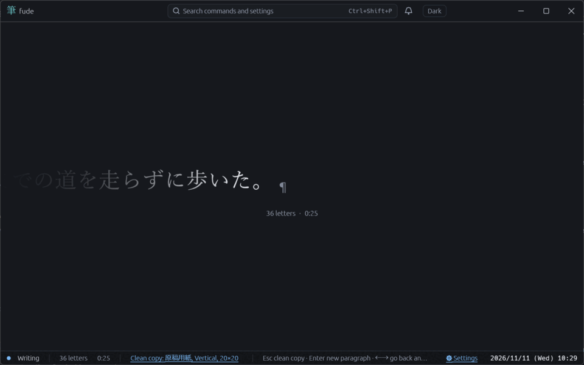
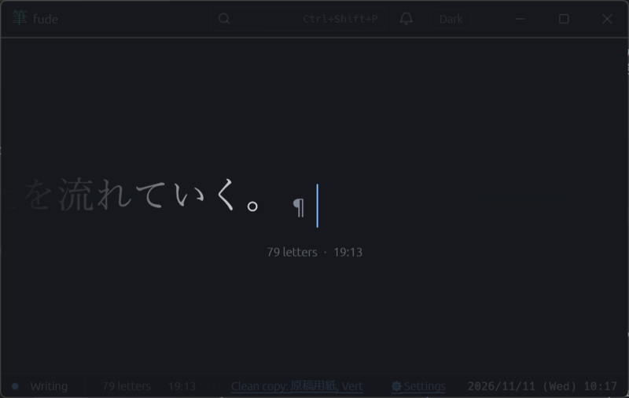
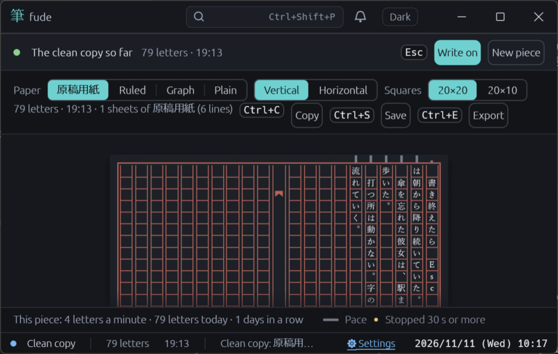

# fude

A one-line text editor for writing, where your eyes never move. The typing spot stays put and the text flows across the band. Use ←→ to go back and fix, and press Esc when you're done to see a clean copy (manuscript paper, ruled, grid, or plain; vertical or horizontal). Built with Rust and egui; Windows first, with macOS and Linux on x86_64 and ARM64. Shared parts (window, theme, language, keys, help, palette, bug reports) come from [ito](https://github.com/uchmk/ito).

## Writing

- **Band**: a single line, horizontal or vertical. Japanese input (IME) converts at the typing spot. Enter starts a new paragraph.
- **Limits**: a character count and a time limit. When reached, the band tells you and a small bell rings once. The screen doesn't change; you can keep writing.
- **Unerasable mode**: going back and deleting are off, so you only write forward.
- **Typing sounds**: none, typewriter, or pencil. The sounds are generated in code.
- **Drafts**: close the app and reopen it to continue where you left off.

## Clean copy (Esc)

- Manuscript paper in 20×20 and 20×10 (and other grids). Vertical text gets page numbers, fish-tail folds, and the correct glyph forms for 「 」 and ー; leading 、。 are hung or pushed onto the previous line.
- Ruby (`｜漢字《かんじ》`) and emphasis dots (`《《emphasis》》`).
- Outside the lines: a speed bar for how fast each line was written, and a dot where you paused for 30 seconds or more (screen only).
- Ctrl+C copies, Ctrl+E exports to PDF/PNG, Ctrl+P prints. Click a character or start typing to go back to the writing view.

## Notebooks and shelf (Ctrl+O)

Writing is bound into notebooks. A notebook is a folder under `Documents\fude\<notebook name>\`, and each piece is one `YYYY-MM-DD_HHMM.txt` file (UTF-8, LF, one paragraph per line). You can open them in Notepad, and a .txt you place there by hand also shows up as a piece. Paper, limits, and prompts are kept per notebook in that folder's `fude.toml`. The shelf shows today's character count, the number of days in a row you've written, and characters per minute.

## Keys

| Key | Action |
| --- | --- |
| Esc | Clean copy / back to writing |
| Ctrl+N | Close this piece and start a new one |
| Ctrl+O | Shelf |
| Ctrl+S | Save this piece now |
| Ctrl+, | Settings |
| F1 | Key list |
| Ctrl+Shift+P | Command palette |
| Ctrl+E / Ctrl+P | Export / print |
| F12 | Report a bug |

You can rebind keys in Settings, or edit `keymap.toml` (changes apply immediately).

## Settings and files

- Settings live in `config.toml`. Language, scale, and theme are in the shared `common.toml` (see ito's [common-spec.md](https://github.com/uchmk/ito/blob/main/docs/common-spec.md)).
- Window position and drafts are state the app writes and reads back. They're stored as TOML in the state folder.

## Windows `fude.com`

`fude.exe` is a GUI program, so PowerShell doesn't wait for it to exit. `cargo build --release` also builds `fude-com.exe`; copy it next to `fude.exe` as `fude.com` and `fude --version` etc. print to the terminal (same as `kura.com` in kura).

When reporting a bug, paste the output of `fude env`. It shows the version, OS, config and state folders, notebook location, the previous window's GPU, and doesn't open a window.

## Build

    cargo run

The Japanese version is in [README.ja.md](README.ja.md).
